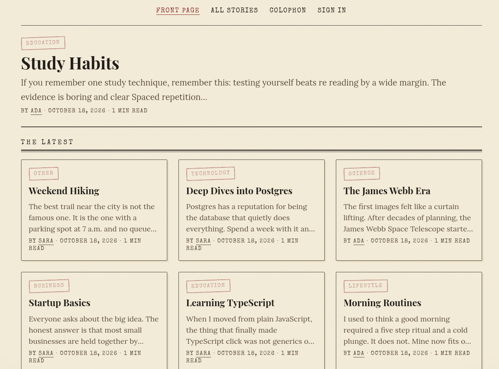
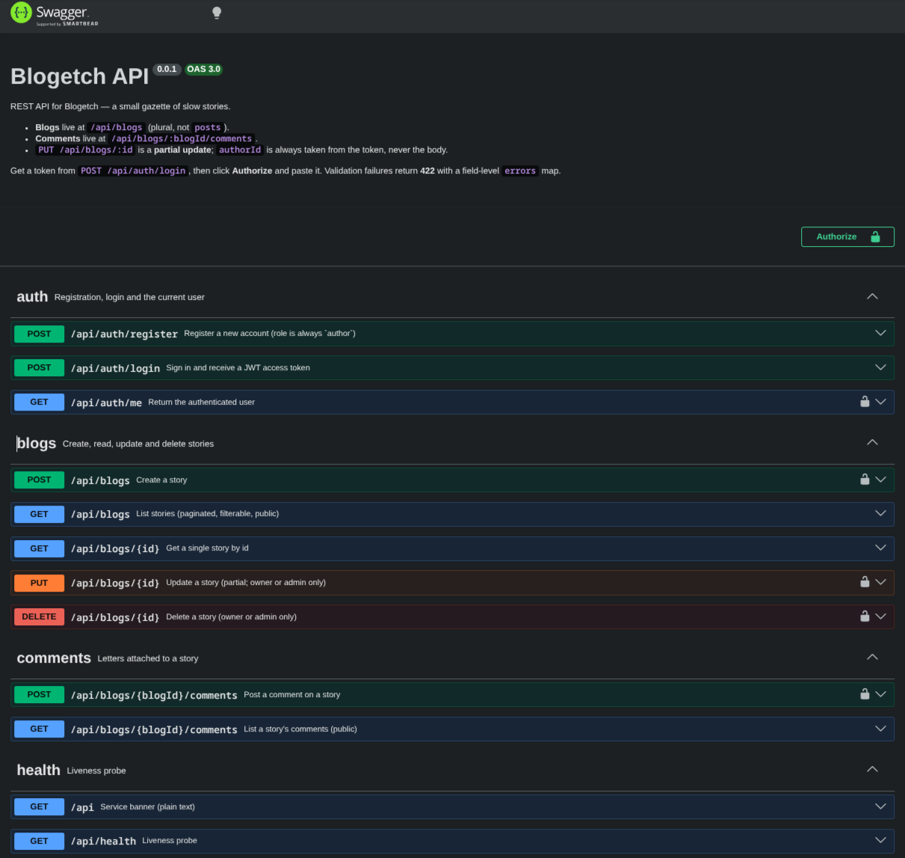

  

<h1 align="center">Blogetch</h1>

<em>Sketch your thoughts. Print them proud.</em>

  
  
  
  
  
  
  

A nostalgic, old-school **gazette** for slow stories: a NestJS REST API and a
Next.js frontend in a single pnpm workspace, backed by PostgreSQL + Prisma.

## Features

- Email/password auth with JWT (`author` + `admin` roles, ownership checks)
- Story CRUD with pagination, search and category/date/author filters
- Markdown rendering with GitHub-flavoured markdown
- Comments ("letters") on every story
- Field-level **422** validation errors, server-rendered Next.js App Router UI
- Auto-generated **Swagger / OpenAPI** docs at `/api/docs`
- Full-stack Docker Compose: database, API, web and pgweb

## Stack

- **Backend:** NestJS 11 · PostgreSQL 16 · Prisma 7 · Passport JWT
- **Frontend:** Next.js 16 (App Router) · React 19 · Tailwind CSS

## Screenshots

  

[//]: # ()
[//]: # (
)

[//]: # (  )

[//]: # (
)

## Documentation

- [Backend & setup guide](docs/backend.md) — stack, quickstart, environment, API and tests
- [Live API reference](http://localhost:3000/api/docs) — Swagger UI (when running)

## License

[MIT](LICENSE).
